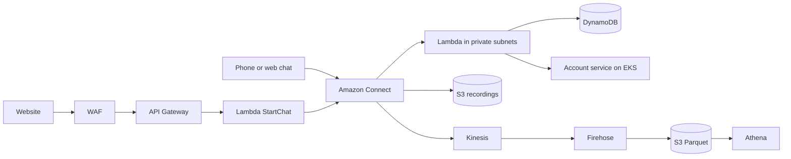

# AWS enterprise bank lab: contact centre platform on AWS

A hands-on build of a contact-centre platform for a fictional Australian bank ("Meridian Bank"), in `ap-southeast-2` (Sydney). It covers Amazon Connect integration, a three-tier VPC with private endpoints, serverless services, a containerised backend on EKS, a streaming data pipeline, and the infrastructure as code and clean-up tooling to run it safely.

Meridian Bank is fictional. No real customer, account or bank data is in this repository.

> **Cost warning.** Some parts bill by the hour even when idle: EKS, the NAT gateway, interface VPC endpoints, Kinesis shards, a claimed phone number and a WAF web ACL. Every one of them is behind a switch that defaults to **off**. Read [`docs/CLEANUP.md`](docs/CLEANUP.md) before you apply anything, and set a budget alarm first.

## What is in here

| Path | What it is |
|---|---|
| [`docs/RUNBOOK.md`](docs/RUNBOOK.md) | **Start here.** Step-by-step for GitHub, Terraform and CloudFormation, with destroy and troubleshooting. |
| [`docs/REPO-PUSH.md`](docs/REPO-PUSH.md) | Publishing the repo to GitHub in detail. |
| [`docs/ARCHITECTURE.md`](docs/ARCHITECTURE.md) | The design in plain English, with the proper technical terms beside each idea. Mermaid diagrams. |
| [`docs/PLAYBOOK.md`](docs/PLAYBOOK.md) | All 19 lab modules, each as goal, architecture, commands, Terraform, cleanup. |
| [`docs/CLEANUP.md`](docs/CLEANUP.md) | What costs money, in order, and how to switch it off. |
| [`terraform/`](terraform) | Modular Terraform: network, security, data, compute, containers, observability. |
| [`cloudformation/`](cloudformation) | The same estate as four independent CloudFormation stacks, with deploy and destroy scripts. |
| [`app/lambdas/`](app/lambdas) | Five Python 3.12 Lambda functions used by the contact flows. |
| [`app/account-service/`](app/account-service), [`app/k8s/`](app/k8s) | A small Flask service, its Dockerfile and Kubernetes manifest. |
| [`cleanup/stop-the-meter.sh`](cleanup/stop-the-meter.sh) | CloudShell script that finds and deletes lab resources. Dry run by default. |
| [`tools/`](tools) | Offline format and cross-reference checkers for the Terraform. |
| [`.github/workflows/ci.yml`](.github/workflows/ci.yml) | Static checks. Uses no AWS credentials. |

## Architecture at a glance



## Quick start (cheap profile)

Needs Terraform 1.6 or newer, AWS credentials for a sandbox account, and a budget alarm.

```bash
cd terraform
terraform init
terraform plan  -var-file=envs/minimal.tfvars
terraform apply -var-file=envs/minimal.tfvars
terraform output cost_switches
```

The minimal profile builds the VPC, subnets, route tables, security groups, gateway endpoints, flow logs, Lambdas, API Gateway, DynamoDB, S3, ECR, Glue and Athena. All of that costs cents when idle.

Tear it down the same day:

```bash
terraform destroy -var-file=envs/minimal.tfvars
```

## Cost switches

| Variable | Default | Turns on | Approx. cost while on |
|---|---|---|---|
| `enable_nat` | false | NAT gateway + Elastic IP | 1.40 USD/day plus data |
| `enable_interface_endpoints` | false | 8 interface endpoints x 3 AZs | 5 to 6 USD/day |
| `enable_eks` | false | EKS cluster + 2 nodes (needs `enable_nat`) | 3 to 5 USD/day at standard support |
| `enable_kinesis` | false | `MB-CTR`, `MB-AgentEvents` streams | per shard-hour |
| `enable_firehose` | false | Firehose to Parquet (needs `enable_kinesis`) | cents |
| `enable_waf` | false | WAF web ACL on the API | about 5 USD/month plus rules |
| `enable_alarms` | false | CloudWatch alarms + SNS | cents |
| `enable_evidence_bucket` | false | Object Lock evidence bucket | cents |
| `enable_flow_logs` | true | VPC Flow Logs | cents |

`envs/full.tfvars` turns the paid ones on. Use it for a few hours, then destroy.

Amazon Connect itself (instance, flows, queues, Lex, Contact Lens, Q) is built in the console, as the lab teaches. Terraform wires Lambdas, recordings storage and Kinesis to an instance whose ID you pass in `connect_instance_id` with `wire_connect = true`.

## CloudFormation instead

```bash
cd cloudformation
./deploy.sh data
./deploy.sh network
./deploy.sh compute
./deploy.sh containers
./seed-dynamodb.sh
./destroy.sh       # dry run by default; add --yes
```

## Checks

CI runs `terraform fmt`, `init -backend=false`, `validate`, TFLint, a Trivy configuration scan, `cfn-lint`, ShellCheck, a Python compile, and a scan for committed account IDs and keys. Locally, `python3 tools/tf_fmt_check.py $(find terraform -name "*.tf")` and `python3 tools/tf_static_check.py terraform` give offline checks.

## Honest limits

* The Terraform has been formatted and cross-reference checked offline. The first `terraform plan` on a real account is a review, not a formality.
* The CloudFormation passes `cfn-lint`. It has not been deployed by its author's tooling.
* Amazon Connect Global Resiliency is not available in Australia, so this is a single-Region design with that risk stated, not hidden.

## Licence

MIT. See `LICENSE` if you add one; otherwise treat the code as a learning reference.
