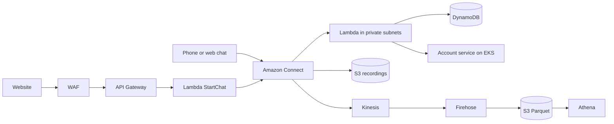

# AWS enterprise bank lab: contact centre platform on AWS

[](https://github.com/asvinluan/aws-enterprise-bank-lab/actions/workflows/ci.yml)


## At a glance

| | |
|---|---|
| **What** | Infrastructure as code, documentation and clean-up tooling for a contact-centre platform on AWS, built around a fictional Australian bank. |
| **Why** | To learn and show how an Amazon Connect integration sits inside an enterprise AWS estate: private networking, containers, streaming data, security controls and cost control. |
| **Built with** | Terraform (6 modules), CloudFormation (4 stacks), Python 3.12 Lambdas, Kubernetes on EKS, GitHub Actions, PowerShell and bash. |
| **Status** | Personal lab. CI is green. The infrastructure code is validated statically and has not been applied from this repository. See [Honest limits](#honest-limits). |
| **Cost** | Every hourly-billed service is behind a switch that defaults to off. `cleanup/stop-the-meter.sh` finds and removes what is left. |

### Skills this repository shows

Infrastructure as code (Terraform modules, provider pinning, lock file, CloudFormation stacks) · CI for infrastructure (fmt, validate, TFLint, Checkov, cfn-lint, ShellCheck, secret scan) · AWS networking (three-tier VPC, gateway and interface endpoints, endpoint policies) · Containers (ECR, EKS, Kubernetes manifests) · Serverless (Lambda, API Gateway, DynamoDB) · Streaming data (Kinesis, Firehose, S3, Athena) · Security (KMS, Secrets Manager, WAF, least-privilege IAM) · Cost control (FinOps: Cost Explorer, a dry-run clean-up tool) · Technical writing (architecture guide, playbook, runbooks for bash and PowerShell).

### Where to look first

1. [`docs/ARCHITECTURE.md`](docs/ARCHITECTURE.md) for the design in plain English.
2. [`terraform/modules/network`](terraform/modules/network) for the VPC and endpoint design.
3. [`cleanup/stop-the-meter.sh`](cleanup/stop-the-meter.sh) for the cost-control tooling, and [`docs/CLEANUP.md`](docs/CLEANUP.md) for why it exists.
4. [`.github/workflows/ci.yml`](.github/workflows/ci.yml) for the four CI jobs.

A hands-on build of a contact-centre platform for a fictional Australian bank ("Meridian Bank"), in `ap-southeast-2` (Sydney). It covers Amazon Connect integration, a three-tier VPC with private endpoints, serverless services, a containerised backend on EKS, a streaming data pipeline, and the infrastructure as code and clean-up tooling to run it safely.

Meridian Bank is fictional. No real customer, account or bank data is in this repository.

> **Cost warning.** Some parts bill by the hour even when idle: EKS, the NAT gateway, interface VPC endpoints, Kinesis shards, a claimed phone number and a WAF web ACL. Every one of them is behind a switch that defaults to **off**. Read [`docs/CLEANUP.md`](docs/CLEANUP.md) before you apply anything, and set a budget alarm first.

## What is in here

| Path | What it is |
|---|---|
| [`docs/RUNBOOK-POWERSHELL.md`](docs/RUNBOOK-POWERSHELL.md) | **Start here on Windows.** Step-by-step in PowerShell for GitHub, Terraform and CloudFormation, with destroy and troubleshooting. |
| [`docs/RUNBOOK.md`](docs/RUNBOOK.md) | The same runbook for AWS CloudShell (bash). |
| [`docs/REPO-PUSH-POWERSHELL.md`](docs/REPO-PUSH-POWERSHELL.md), [`docs/REPO-PUSH.md`](docs/REPO-PUSH.md) | Publishing the repo to GitHub (PowerShell, bash). |
| [`docs/ARCHITECTURE.md`](docs/ARCHITECTURE.md) | The design in plain English, with the proper technical terms beside each idea. Mermaid diagrams. |
| [`docs/PLAYBOOK.md`](docs/PLAYBOOK.md) | All 19 lab modules, each as goal, architecture, commands, Terraform, cleanup. |
| [`docs/CLEANUP.md`](docs/CLEANUP.md) | What costs money, in order, and how to switch it off. |
| [`terraform/`](terraform) | Modular Terraform: network, security, data, compute, containers, observability. |
| [`cloudformation/`](cloudformation) | The same estate as four independent CloudFormation stacks, with deploy and destroy scripts. |
| [`app/lambdas/`](app/lambdas) | Five Python 3.12 Lambda functions used by the contact flows. |
| [`app/account-service/`](app/account-service), [`app/k8s/`](app/k8s) | A small Flask service, its Dockerfile and Kubernetes manifest. |
| [`cleanup/stop-the-meter.sh`](cleanup/stop-the-meter.sh) | CloudShell script that finds and deletes lab resources. Dry run by default. |
| [`tools/`](tools) | Offline format and cross-reference checkers for the Terraform. |
| [`.github/workflows/ci.yml`](.github/workflows/ci.yml) | Static checks. Uses no AWS credentials. |

## Architecture at a glance



## Quick start (cheap profile)

Needs Terraform 1.6 or newer, AWS credentials for a sandbox account, and a budget alarm.

```bash
cd terraform
terraform init
terraform plan  -var-file=envs/minimal.tfvars
terraform apply -var-file=envs/minimal.tfvars
terraform output cost_switches
```

The minimal profile builds the VPC, subnets, route tables, security groups, gateway endpoints, flow logs, Lambdas, API Gateway, DynamoDB, S3, ECR, Glue and Athena. All of that costs cents when idle.

Tear it down the same day:

```bash
terraform destroy -var-file=envs/minimal.tfvars
```

## Cost switches

| Variable | Default | Turns on | Approx. cost while on |
|---|---|---|---|
| `enable_nat` | false | NAT gateway + Elastic IP | 1.40 USD/day plus data |
| `enable_interface_endpoints` | false | 8 interface endpoints x 3 AZs | 5 to 6 USD/day |
| `enable_eks` | false | EKS cluster + 2 nodes (needs `enable_nat`) | 3 to 5 USD/day at standard support |
| `enable_kinesis` | false | `MB-CTR`, `MB-AgentEvents` streams | per shard-hour |
| `enable_firehose` | false | Firehose to Parquet (needs `enable_kinesis`) | cents |
| `enable_waf` | false | WAF web ACL on the API | about 5 USD/month plus rules |
| `enable_alarms` | false | CloudWatch alarms + SNS | cents |
| `enable_evidence_bucket` | false | Object Lock evidence bucket | cents |
| `enable_flow_logs` | true | VPC Flow Logs | cents |

`envs/full.tfvars` turns the paid ones on. Use it for a few hours, then destroy.

Amazon Connect itself (instance, flows, queues, Lex, Contact Lens, Q) is built in the console, as the lab teaches. Terraform wires Lambdas, recordings storage and Kinesis to an instance whose ID you pass in `connect_instance_id` with `wire_connect = true`.

## CloudFormation instead

```bash
# bash / CloudShell. On Windows PowerShell use deploy.ps1, destroy.ps1 and seed-dynamodb.ps1 instead.
cd cloudformation
./deploy.sh data
./deploy.sh network
./deploy.sh compute
./deploy.sh containers
./seed-dynamodb.sh
./destroy.sh       # dry run by default; add --yes
```

## Checks

CI runs `terraform fmt`, `init -backend=false`, `validate`, TFLint, a Checkov scan (pinned to 3.3.20, report-only), `cfn-lint`, ShellCheck, a Python compile, and a scan for committed account IDs and keys. Locally, `python3 tools/tf_fmt_check.py $(find terraform -name "*.tf")` and `python3 tools/tf_static_check.py terraform` give offline checks.

## Honest limits

* The Terraform has been formatted and cross-reference checked offline. The first `terraform plan` on a real account is a review, not a formality.
* The CloudFormation passes `cfn-lint`. It has not been deployed by its author's tooling.
* Checkov reports about 100 findings in report-only mode. None are remediated yet, and some are false alarms (for example, S3 encryption is declared in a separate resource).
* The PowerShell scripts were tested on PowerShell 7 against a stub AWS CLI, not on a real account.
* The code and documents were drafted with AI assistance, then reviewed, run and checked by the author.
* Amazon Connect Global Resiliency is not available in Australia, so this is a single-Region design with that risk stated, not hidden.

## What went wrong, and what it taught me

* **Idle services still bill.** After the lab modules were finished, a month-to-date bill of USD 36.94 showed hourly charges still running. The largest single item was an API Gateway **stage cache**, which kept billing after its API had been removed from view. Finding it took Cost Explorer grouped by usage type, which is why `stop-the-meter.sh usage` exists.
* **Deleting needs guard rails.** The clean-up script runs as a dry run by default, only touches resources named `MB-*`, `mb-*` or `meridian-lab*` (or in the VPC tagged `mb-vpc`), and puts phone numbers, the Connect instance and KMS keys behind explicit flags.
* **CI finds real problems.** The first runs failed on an unresolvable scanner version and on TFLint warnings (missing `required_version` and `required_providers` in each module). Both are fixed and each module now has a `versions.tf`.
* **Old Kubernetes versions cost more.** A cluster on a version past standard support is billed at the extended-support rate from its first hour, so the Terraform defaults to a version still in standard support.

## Licence

MIT. See [`LICENSE`](LICENSE).
