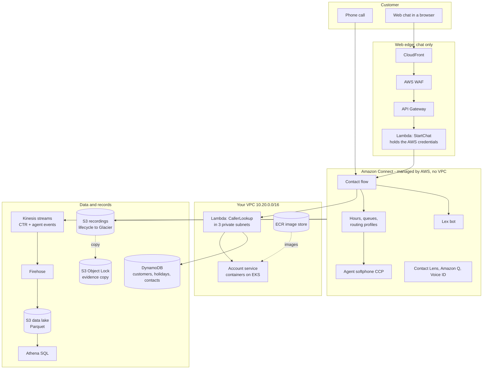
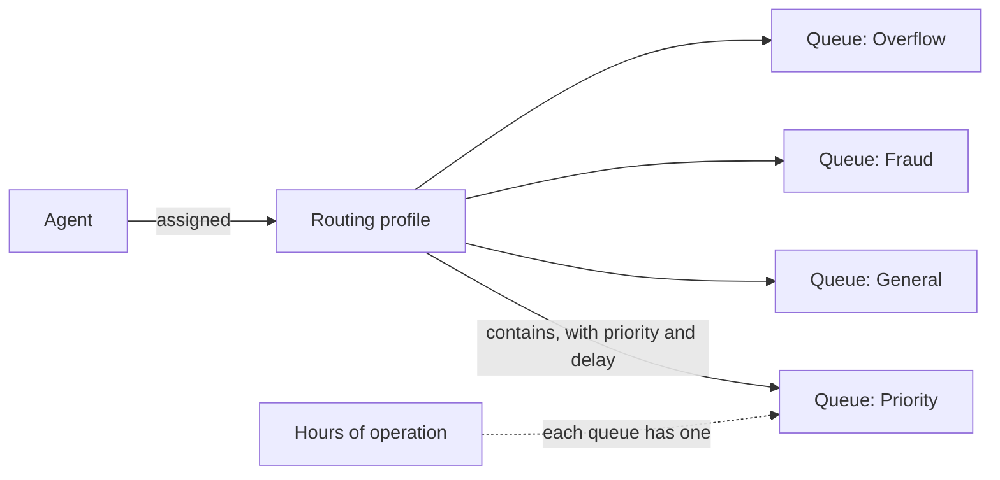
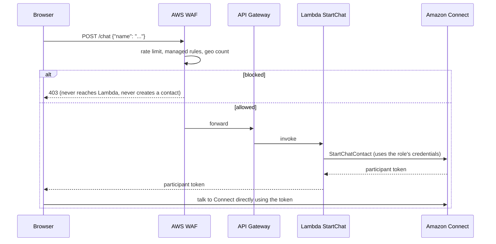
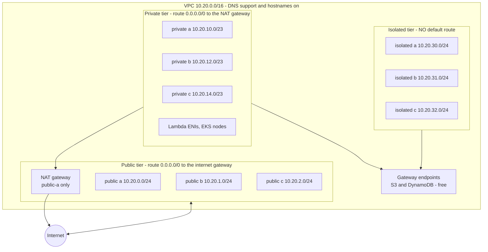
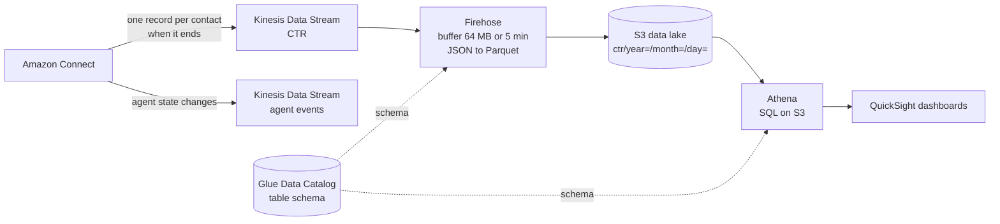

# Architecture guide: the Meridian Bank contact centre on AWS

This guide explains what was built, in plain English, and attaches the proper technical term to each idea so the vocabulary becomes familiar. Every section follows the same pattern:

* **Plain English**: what it is and why it exists, with no jargon.
* **Technical terms**: the words an AWS engineer or an interviewer will use.
* **In this lab**: the exact resource, where it lives in this repository.
* **Say it like this**: a sentence you can use in an interview.

Meridian Bank is fictional, modelled on a large Australian bank. Everything runs in the Sydney Region, `ap-southeast-2`.

---

## 1. The picture on one page

A customer needs help. They phone, or chat from the website, or ask for a callback. The platform has to identify them, decide how urgent they are, work out what they want, look up their details, put them in the right queue, connect them to an agent, record the conversation, keep the recording for seven years, and produce data the business can report on.



Around all of it sit IAM (who may do what), KMS (encryption keys), CloudWatch (logs, metrics, alarms), CloudTrail (who changed what), and Terraform or CloudFormation (the whole estate as code).

---

## 2. Three boundaries that explain most of the confusion

**Managed versus yours.** Amazon Connect is fully managed. There is no server, no VPC, no Availability Zone selector and no EC2 instance behind it. You configure it and AWS runs it. Everything else in the diagram is yours to build, secure and operate.

**Voice versus web.** A phone call arrives over the telephone network and lands directly in Connect. A chat arrives over the internet as an HTTPS request. That single difference is why WAF, API Gateway and CloudFront appear only on the chat path: WAF only understands web requests.

**Serverless versus containers.** Connect and Lambda are serverless: you give AWS code or configuration, and AWS decides where it runs. The bank's own business services (account lookup, payments) are usually long-running containers on Kubernetes, because banks adopted Kubernetes years before Connect. Your Lambda calls those services. You are a consumer of EKS, not an operator of it.

> **Say it like this:** "Connect never touches my VPC. Connect invokes a Lambda; the Lambda lives in the VPC; the Lambda reaches core banking. Connect stays outside the whole time."

---

## 3. Foundations: account, Region, identity, encryption

### Region and Availability Zone

**Plain English.** A Region is a geographic area with a cluster of AWS data centres (Sydney is `ap-southeast-2`). An Availability Zone (AZ) is one or more separate data centres inside that Region, with independent power and networking. Spreading across three AZs means one building failing does not take you down.

**Technical terms.** Region, AZ, AZ name versus **AZ ID**. The name `ap-southeast-2a` maps to different physical zones in different accounts (AWS shuffles them to spread load); the ID, such as `apse2-az1`, is the same everywhere. In a bank with dozens of accounts, checking IDs is the difference between a real multi-AZ design and an accidental single-AZ one.

**In this lab.** The `private_subnet_zone_ids` Terraform output shows the three IDs. They must all be different.

### Accounts, Organizations and Service Control Policies

**Plain English.** A real bank does not put everything in one AWS account. It uses many accounts, grouped into folders, so that a mistake or a break-in in one cannot reach the others.

**Technical terms.** AWS Organizations, Organizational Unit (OU), **Service Control Policy (SCP)**, Log Archive account, Evidence account, Network account. An SCP is a hard deny applied to a whole OU: "no resource may be created outside Australian Regions" is a data-residency control that an engineer cannot bypass, even by accident. Service quotas are per account, so dev load testing cannot use up production's call capacity.

**In this lab.** A single account. The organisation layout is a design study, not something you build.

### IAM: who and what is allowed to do which action

**Plain English.** IAM is the bouncer's guest list. Every person and every piece of code gets a list of exactly what it may do, and nothing more.

**Technical terms.** **Role** (an identity code assumes, with short-lived credentials), **policy** (the JSON list of allowed actions and resources), **least privilege**, trust policy (who may assume the role), managed policy versus inline policy, resource ARN (Amazon Resource Name, the unique address of a thing).

**In this lab.** One role, `MB-LambdaRole`, shared by the Lambdas. Look at what it deliberately lacks: no `dynamodb:Scan` (a scan reads every row; if your code needs one, the data model is wrong), no `DeleteItem` (nothing in this application deletes), no wildcard on tables or buckets. `terraform/modules/security/main.tf`.

> **Say it like this:** "If the code is compromised, the role limits the damage. It can read two tables and write one. It cannot delete anything or list everything."

### KMS: encryption keys you control

**Plain English.** KMS holds the keys that lock your data. A customer-managed key means you decide who may use it, you can see every use in the audit log, and you can switch it off.

**Technical terms.** Customer managed key (CMK), key policy, key rotation, **SSE-KMS** (server-side encryption with KMS), **bucket key** (cuts KMS request costs by roughly 99 percent), key deletion waiting period (7 to 30 days; a deleted key makes everything it encrypted unreadable).

**In this lab.** One key, alias `alias/mb-recordings`, used by the recordings bucket, the data lake and ECR. It costs about 1 USD a month while it exists.

---

## 4. The contact centre: Amazon Connect

### What Connect is

**Plain English.** A phone system in a box. It answers calls, plays messages, asks questions, queues callers, connects them to agents, records the call, and reports on it. You configure it through a website; you do not run servers.

**Technical terms.** **Instance** (your private Connect), **access URL** (`meridian-cc.my.connect.aws`), identity management (store users in Connect, or federate through SAML; this is permanent and cannot be changed later), claimed phone number, **CCP** (Contact Control Panel, the agent's softphone), contact (one call, chat or task).

Two consoles, and mixing them up wastes hours: the **AWS Console** manages the instance (integrations, storage, telephony, data streaming); the **admin website** is where you build flows, queues, users and hours.

### The routing model

**Plain English.** You never put an agent "in a queue". You put queues into a **routing profile**, and give the profile to the agent.



| Thing | Plain English | In this lab |
|---|---|---|
| **Hours of operation** | When a queue is open. Uses an IANA time zone, so daylight saving is automatic. | `MB-Hours-Business`, and `MB-Hours-24x7` for fraud (a stolen card is a loss clock, not a business-hours problem) |
| **Queue** | A waiting line with its own limits and reporting. | Priority, General, Fraud, Overflow. **Maximum contacts** is set on each; without it the "at capacity" branch never fires. |
| **Routing profile** | The list of queues an agent serves, with a priority and a delay for each. | Fraud, Priority, General, Universal |
| **Priority** | Which queue an available agent is served from first. Lower number wins and overrides wait time. | |
| **Delay** | The agent is ineligible for that queue for N seconds. | The Universal profile gives the dedicated priority team 30 seconds before a universal agent is offered the call. |
| **Quick connect** | A shortcut in the agent's transfer list. Must be attached to the agent's queue or it does not appear. | |

The trap to name before an interviewer does: priority overrides wait time, so with enough priority volume the general queue starves. Watch `LongestQueueWaitTime`, and age long-waiting contacts into the overflow pool. The customer queue flow in this lab does exactly that after five minutes.

### Contact flows

**Plain English.** A flowchart that runs when someone calls: greet, identify, branch, queue. It is the most important artefact in the platform and the one most often built badly.

**Technical terms.** **Block**, **branch** (Success, Error, Timeout, No match), **module** (a reusable group of blocks), **customer queue flow** (what the caller hears while waiting), **break-glass flow**, **contact attribute** (a string stored on the contact), `$.Attributes` versus `$.External`.

Two rules make a flow complete:

1. **Every branch lands somewhere.** An unconnected branch silently disconnects the caller. It is the top cause of unexplained call drops, and the designer will not warn you.
2. **Transfer to queue, Success must be connected** (normally to End flow / Resume), or the transfer does not complete properly.

A third trap: `$.External` holds only the most recent Lambda response. A second invocation silently destroys the first one's values. Copy what you need into user-defined attributes straight after each Lambda.

**The break-glass flow.** A four-block flow whose only job is to get the caller to a human. At 2am, when the main flow is broken, repointing the phone number to it takes fifteen seconds. Debugging takes an hour and you will make it worse.

**When the queue is full**, nothing happens automatically. The order to defend: overflow to a broader pool (humans first), then callback holding their place, then bounded self-service, then voicemail or task, then an apology with another channel. Never go straight to a disconnect, and never make AI the first fallback: it disguises a staffing failure as automation success.

### Amazon Lex: let the caller say what they want

**Plain English.** Instead of "press 3 for lending, then 2 for existing loans", the caller says "I want to talk about my mortgage" and Lex works out what they meant.

**Technical terms.** **Bot**, **intent** (what the caller wants), **utterance** (example phrases), **slot** (a detail Lex must collect, such as an amount), **slot type**, **confidence threshold** (below it, Lex returns the fallback intent; this lab raises it from 0.40 to 0.55), **slot obfuscation**, **version and alias**, **DTMF** (touch tones).

Banking details that matter: restrict slot values so your code never sees an undefined value; put a confirmation prompt on any intent that moves money; turn on **slot obfuscation** so amounts do not accumulate in CloudWatch logs (a data-minimisation control under the Australian Privacy Principles); point the flow at an **alias**, not a version, so a release is "repoint the alias" and a rollback is "repoint it back"; and always configure DTMF on the same block, because a caller reporting a stolen card from a hands-free car kit will fail speech recognition.

### The three tiers of AI, and the risk boundary

| | Conversational (Lex) | Generative (Amazon Q, Bedrock) | Agentic (AI agents) |
|---|---|---|---|
| What it does | Matches an utterance to a predefined intent | Writes language from a knowledge base | Reasons across steps, calls tools, completes work |
| Behaviour | Deterministic | Probabilistic within guardrails | Autonomous within a tool boundary |
| Failure | Wrong intent or fallback | Hallucination | Wrong action taken |
| Risk | Low | Medium | Highest: it acts |

* **Contact Lens** analyses what was said: sentiment, categories, redaction of sensitive data. Turn redaction on from day one; it applies at analysis time and cannot be retrofitted to transcripts already produced.
* **Amazon Q in Connect** gives the agent answers during the call. Content governance is the product: it surfaces what is in the knowledge base, so an outdated fee schedule produces outdated answers, faster.
* **Amazon Bedrock Guardrails** are the technical implementation of a licensing boundary: a denied topic of "financial advice" stops the bank's model from giving personal financial advice. Create the guardrail first, version it, and reference the version.
* **Voice ID** authenticates by voiceprint. A voiceprint is biometric information: it needs explicit consent and an opt-out that does not penalise the caller. Treat it as one factor.

> **Say it like this:** "I scope AI by the cost of it being wrong. For a balance enquiry the worst case is a re-ask. For fraud reporting it is money out the door while the model reasons. Those are different risk appetites, so they do not get the same automation."

---

## 5. Application layer: DynamoDB and Lambda

### DynamoDB

**Plain English.** A very fast lookup table. You hand it a phone number and it hands back the customer in a few thousandths of a second, however many customers there are.

**Technical terms.** **Table**, **partition key** (the one field you look up by), item, **on-demand capacity** (pay per request, nothing when idle, handles 9am spikes), `GetItem` versus `Scan`, TTL (time to live, automatic expiry), point-in-time recovery.

**Why not a relational database?** Three parts. *Access pattern*: one customer by one phone number is a single-key read, which is what DynamoDB is built for. *Concurrency*: a hundred concurrent Lambdas means a hundred database connections, and connection pools run out long before CPU does; DynamoDB has no connection pool. *The honest trade-off*: DynamoDB is bad at queries you did not design for, so ad-hoc reporting belongs elsewhere, fed from a stream (that is the Kinesis and Athena path below).

**In this lab.** `MB-Customers` (key `phoneNumber`), `MB-Holidays` (key `holidayDate`), `MB-Contacts` (key `contactId`, written during the call and read after it, with a TTL). `terraform/modules/data/dynamodb.tf`.

### Lambda

**Plain English.** A small piece of your code that AWS runs on demand and bills by the millisecond. The contact flow calls it mid-call to look something up and hands the answer back to the flow.

**Technical terms.** Function, runtime (Python 3.12), architecture (arm64), handler, timeout, **cold start** (the extra time when AWS starts a fresh copy), environment variables, execution role, **VPC-attached Lambda** (gets a network interface in your subnets), **reserved and burst concurrency**.

The five constraints to know cold:

| Constraint | Value | Consequence |
|---|---|---|
| Connect's invocation timeout | 8 seconds | Set the function timeout to exactly 8. Higher is pointless. |
| Response size | under 32 KB | Return what the flow needs, not the whole record. |
| Contact attributes | strings only | A Python `True` becomes `"True"` and breaks a lowercase comparison. |
| Retries | on throttling and 5xx | Anything that creates a record needs an idempotency guard. |
| `$.External` | most recent response only | Copy values out immediately after each Lambda. |

Design rules visible in the code: every return path returns every key; nothing raises (a caught error becomes a status code the flow can branch on); clients are created outside the handler so warm invocations reuse them; configuration is in environment variables so the same artefact promotes from dev to production; **fail open on the holiday check, fail closed on authentication**.

**Idempotency.** Connect retries a Lambda up to three times on a 5xx and a retry looks identical to a first call. For anything that creates something, derive the key from the `ContactId` (stable across retries) and back it with a conditional write (`attribute_not_exists`), so only one write wins.

**The five functions** (`app/lambdas/`): `CallerLookup` (who is calling, in the VPC), `HolidayCheck` (greeting and closure, fails open), `StartChat` (the credential broker), `RecordingRouter` (sorts recordings by tier after the call), `SendSms` (never raises).

---

## 6. The web edge: CloudFront, WAF, API Gateway

**Plain English.** A browser can never hold AWS credentials; anyone can read a web page's source. So the website knocks on a door (API Gateway), which wakes a piece of code (Lambda) that holds the credentials and starts the chat on the customer's behalf. A bouncer (WAF) stands in front of the door.



**The vulnerability being defended.** That endpoint is public and unauthenticated by design (the customer has not logged in), and its address is in the page source. Anyone can script it, and each call creates a real, billable chat contact. An attacker with a laptop can flood the queues, exhaust the concurrent chat quota, waste agent time and run up the bill. It looks like a contact-centre problem for the first hour, not a security incident.

| WAF rule | What it does | Why |
|---|---|---|
| **Rate-based, 100 per 5 minutes per IP, block** | One person can start a few chats a minute, not a few thousand. | Stops the lazy attack and the accidental one (a broken integration retrying in a loop). Honest limit: an attacker rotating IPs stays under it. |
| **AWS managed rule groups** (Common, Known Bad Inputs) | AWS writes and updates the rules. | You get AWS's threat research without writing rules. |
| **Geo match, not-Australia, count** | Counts, does not block. | Customers travel and use VPNs. Blocking locks out your own customer in Bali. Count first, tighten with data. |

A blocked request never reaches API Gateway, never invokes the Lambda and never creates a contact: you pay the WAF request charge and nothing else.

**The boundary.** WAF governs contact **initiation**, not contact **content**. Once the browser holds a participant token it talks to Connect's own service, which you cannot attach a web ACL to. Controlling what is typed during a chat is Contact Lens redaction, Bedrock guardrails and flow logic. **CloudFront** sits in front of the bank's website, filtering at edge locations worldwide, so a real chat path often has two web ACLs: one on CloudFront for the page and one on API Gateway for the chat-start endpoint.

---

## 7. The network: VPC, subnets, routing, endpoints

This is the section with the most new vocabulary. If you come from telephony, the left column is already familiar.

| Telephony | Network | Meaning |
|---|---|---|
| Number range, DDI block | **CIDR block** | A range of addresses, such as `10.20.0.0/16` (65,536 addresses) |
| Trunk group | **Subnet** | A slice of the range, placed in one AZ |
| Dial plan | **Route table** | Rules saying where traffic for a destination goes |
| Least-cost routing | **Route priority and target** | The most specific matching route wins |
| Class of service restriction | **Security group** | A stateful allow-list on a network interface |
| Carrier demarcation | **Internet gateway** | The door to the public internet |
| SBC in the DMZ | **NAT gateway** | Lets private things reach out, but nothing reach in |
| Private interconnect to a carrier | **VPC endpoint, PrivateLink** | A private door to an AWS service |
| Hub-and-spoke SIP topology | **Transit Gateway** | Joins many networks through one hub |
| CDR or SMDR records | **VPC Flow Logs** | A record of who talked to whom |

### The VPC and the three tiers



* **Public** has a route to the internet. In this design only the NAT gateway lives there.
* **Private** has a route out through the NAT but nothing can reach in. Lambda network interfaces and EKS worker nodes live here.
* **Isolated** has no route out at all. A compromised database cannot phone home.

> **The sentence that matters.** A subnet is not private because of a checkbox. It is private because its route table sends `0.0.0.0/0` to a NAT gateway rather than an internet gateway. Change the route and the subnet changes character.

**Why `/23` for the private tier?** Every VPC-attached Lambda invocation can consume an elastic network interface (ENI), and EKS pods consume addresses from the subnet. At bank call volumes this is a real capacity calculation. Running out of addresses at 9am on a Monday looks exactly like a platform outage. (AWS also reserves five addresses in every subnet, so a `/24` gives 251 usable, not 256.)

**Why three AZs?** A VPC-attached Lambda is only as resilient as the subnets you give it. One subnet is one AZ: a single-AZ dependency hiding inside something everyone calls serverless. At a bank that is an audit finding.

### NAT gateway

**Plain English.** A one-way door. Things in the private tier can go out to the internet (to fetch updates, say) and get replies, but nothing from outside can start a connection in.

**Technical terms.** NAT (Network Address Translation), **Elastic IP** (a fixed public address, which AWS bills for), **data processing charge** (per GB through the gateway), one-per-AZ for resilience (which triples the cost).

NAT is the main reason this lab is not free, and it is why VPC endpoints matter so much: sending AWS-service traffic out to the internet and back through a NAT costs money per gigabyte, and a private endpoint does not.

### Security groups versus network ACLs

* A **security group** is a *stateful* allow-list attached to a network interface. If you allow traffic out, the reply is automatically allowed back.
* A **network ACL** is a *stateless* allow-and-deny list attached to a subnet. You must write both directions. Most estates leave NACLs at default and do the work in security groups.

**Security group referencing** is the technique worth knowing. Writing `10.20.10.0/23` as the source works until someone adds a subnet, and then it silently stops covering everything. Referencing the group means the rule follows the workload wherever it runs. In telephony terms: you are permitting by class of service, not by extension number.

```text
Lambda  --(8080)-->  Account service
sg-lambda            sg-account-service
                     ingress: tcp 8080, source = sg-lambda   <- a group, not a CIDR
```

Terraform adds one more lesson. A security group created by Terraform has **no egress rule** (the console adds allow-all for you), so the Lambda's permitted destinations are written explicitly: the account service, the interface endpoints, and the **managed prefix lists** of the S3 and DynamoDB gateway endpoints. Gateway endpoints are reached through a list of the service's addresses, not through your VPC CIDR. Without those two rules a VPC Lambda cannot reach DynamoDB even though the endpoint exists.

### VPC endpoints: where security and cost agree

A VPC-attached Lambda has no internet access by default, so a Lambda that reaches core banking privately suddenly cannot reach DynamoDB, S3 or Bedrock (public AWS endpoints). There are two ways to fix that: route through a NAT, or use endpoints.

| | Gateway endpoint | Interface endpoint (PrivateLink) |
|---|---|---|
| Services | S3 and DynamoDB only | Almost everything else |
| How it works | An entry in your route table | A network interface in your subnets |
| Cost | **Free** | Per hour per AZ, plus per GB |
| In this lab | S3, DynamoDB | `kms`, `secretsmanager`, `kinesis-streams`, `bedrock-runtime`, `ecr.api`, `ecr.dkr`, `logs`, `sts` |

`private_dns_enabled` is what makes interface endpoints transparent: `kms.ap-southeast-2.amazonaws.com` resolves to a private address inside your VPC, so the application code does not change at all.

**Endpoint policies** are the control a bank actually wants. Without one, code inside your VPC can reach any S3 bucket in the world through the endpoint, including an attacker's. With one, the endpoint only permits your buckets. It is a **data-exfiltration control**.

A lesson from building it: a strict S3 endpoint policy that names only your buckets silently breaks container image pulls, because ECR serves image layers from an AWS-owned bucket (`prod-<region>-starport-layer-bucket`). The policy in this repo allows that one extra bucket. Locking down is not the same as switching things off: you have to know what the platform needs.

### Flow logs

The network equivalent of CDRs: source, destination, port, bytes, accepted or rejected. You will not read them daily, and you will be extremely glad they exist the first time someone asks "did anything talk to that address on the fourteenth?"

### The enterprise layer (design study, not built)

Meridian Bank runs hundreds of VPCs, not one. The shape:

| Component | Why it exists |
|---|---|
| **Transit Gateway** | Hub-and-spoke. VPC peering is n(n-1)/2 connections with no transitive routing, so it does not scale. |
| **Redundant Direct Connect** | A single link is a single point of failure for every hybrid integration. Two locations, two providers, VPN as tertiary backup. |
| **Centralised egress** | One account, one inspection point, one set of logs for everything leaving. |
| **Route 53 Resolver** | Hybrid DNS: AWS workloads resolving on-premises names and the reverse. |
| **Network Firewall** | Deep inspection and domain filtering at the egress point. |
| **IPAM** | Address allocation across hundreds of accounts. Overlapping CIDRs can never be joined; fixing it later is a migration. |

> **Say it like this:** "I'd build in a workload account and consume the network as a service from the network account: a Transit Gateway attachment and a CIDR allocation from IPAM. What I own is the VPC design inside my allocation: subnet tiering, endpoint strategy, security groups and the Lambda's AZ spread."

---

## 8. Containers: ECR and EKS

**Plain English.** A *container image* is an application packaged with everything it needs to run, in one file. **ECR** is AWS's private cupboard for those files. **Kubernetes** runs containers for you: starts them, restarts them when they crash, runs several copies, spreads them across machines. **EKS** is AWS running Kubernetes so you do not install and patch it yourself. If ECR is the cupboard, EKS is the kitchen.

**Technical terms.**

| Term | Meaning |
|---|---|
| **Image tag** | A label on an image version. Never deploy `latest`; tag with a version or git hash. This repo makes tags **immutable**. |
| **Scan on push** | ECR checks each pushed image for known vulnerabilities. |
| **Control plane** | The Kubernetes brain, run by AWS. Billed per hour. |
| **Node group, worker node** | The EC2 machines that actually run your containers. |
| **Pod** | The smallest unit: one or more containers that run together. |
| **Deployment, replicas** | "Keep three copies running." |
| **Service** | A stable address in front of the pods. `type: LoadBalancer` makes AWS create a load balancer. |
| **Probes** | `readinessProbe` (ready for traffic?) and `livenessProbe` (still alive?), both calling `/health`. |
| **Topology spread constraint** | Forces replicas onto different zones. Three replicas on one node is three copies of one single point of failure. |
| **Internal load balancer** | The annotation that keeps the balancer on private addresses. A bank's account service must never be reachable from the internet. |

Your Lambda is a **consumer** of this service, not an operator of it. That distinction matters in interviews: the panel is checking your boundaries, not your `kubectl`.

**Why the network came first.** The older version of this lab ran `eksctl create cluster` with no VPC arguments, which silently built a new VPC, so the network was inherited rather than designed. Here the cluster goes into the VPC you built, with `privateNetworking`: the nodes get no public address, pull images through the endpoints and reach the internet through the NAT. That only works because the network exists first.

**A cost lesson.** Each Kubernetes version gets 14 months of standard support, then 12 months of **extended support** at six times the control-plane price. The lab pinned 1.31, which has been in extended support since 26 November 2025. This repo defaults to a newer version and sets `upgrade_policy.support_type = STANDARD`, so when standard support ends AWS upgrades the cluster instead of billing six times more.

---

## 9. Data plane and records: Kinesis, Firehose, S3, Athena

Two different problems: the business needs to **report** on what happened, and the regulator needs the **audio**, years later, provably unaltered.

### Reporting: the pipeline



| Term | Plain English |
|---|---|
| **Contact Trace Record (CTR)** | One record per contact when it ends: timestamps, queue, agent, outcome, and every contact attribute. |
| **Kinesis Data Stream** | A conveyor belt that holds records for a day while something collects them. Billed per **shard**-hour even when empty. |
| **Firehose** | Collects the belt's records, batches them, converts format and drops them in S3. No consumer code to write. |
| **Parquet** | A columnar file format. Athena reads only the columns it needs, so queries are fast and cheap. |
| **Glue Data Catalog** | The table definition: names and types of the columns. Firehose uses it to convert; Athena uses it to query. |
| **Partition, partition projection** | Folders by date. Projection tells Athena the folder pattern, so no repair command is needed after each delivery. |
| **Athena** | SQL directly over files in S3, billed per byte scanned. |

*Data Stream or Firehose?* Firehose if you only need delivery to S3 with buffering and format conversion: simpler and cheaper. A Data Stream if you need several independent consumers or real-time processing. This lab uses a stream as the source and Firehose as the delivery, which gives both.

Because `customerTier` and `lineOfBusiness` are **contact attributes**, they land in the CTR automatically. Per-tier and per-product service-level reporting needs no extra instrumentation. Designing attributes for reporting, not just routing, is a senior habit.

*The distinction you will be asked about:* Kinesis CTRs and agent events are **server-side and authoritative**. The Amazon Connect **Streams API** is JavaScript in the agent's browser, used to embed the CCP in a CRM: a presentation-layer tool. Build reporting on it and you are reporting on what one browser tab happened to see.

### Recordings

Connect writes every call recording to **one** configured S3 location. You cannot branch the destination inside a flow. So separation by customer tier happens **after** the recording lands: an S3 `ObjectCreated` event triggers `RecordingRouter`, which looks up the tier that `CallerLookup` stored in `MB-Contacts` during the call and copies the audio to `recordings/priority/` or `recordings/general/`.

Two layers stop the router recursing forever on its own output: the S3 trigger is filtered to the `connect/` prefix, and the code ignores any key that already starts with `recordings/`. The router deletes the original only **after** the copy succeeds, and re-raises on failure so Lambda retries and the Errors metric rises. Silently swallowing that error loses recordings.

### The five things to know about archiving

1. **Glacier is not a place.** Glacier Instant Retrieval, Flexible Retrieval and Deep Archive are *storage classes* inside an S3 bucket: same bucket, same Region, same key; only the class, cost and retrieval time change.
2. **Instant versus Flexible is a business decision.** Priority audio goes to Instant (millisecond retrieval) because a dispute is exactly the recording someone demands at short notice. General audio goes to Flexible (minutes to hours) because it is pure archive.
3. **The minimum-object-size trap.** By default, objects under 128 KB do not transition to any storage class. Short call recordings are routinely under 128 KB, so the rule looks like it works and nothing archives. Set `transition_default_minimum_object_size = "varies_by_storage_class"`.
4. **Cost mechanics.** 90-day minimum storage duration (180 for Deep Archive), and roughly 40 KB of extra metadata per object for Flexible and Deep Archive. For short recordings, archiving can cost more than leaving them in Standard-IA. Model object count and size first.
5. **Replication interacts badly with Glacier.** Objects already in Flexible or Deep Archive cannot be replicated; Instant Retrieval can. Replicate first, transition second.

### The evidence copy

A separate bucket in a **separate account**, with **S3 Object Lock in Compliance mode**: Compliance cannot be overridden by any user, Governance can. Object Lock must be enabled when the bucket is *created*, so it is an architecture decision, not an operations one. Disable delete-marker replication so a deletion in the operational estate cannot erase the evidence. Replication copies objects, not configuration: lifecycle rules, policies, encryption and versioning do not replicate, which is why both buckets should come from the same Terraform module.

This repo's optional evidence bucket uses **Governance** mode with a one-day retention, deliberately, so you can still clean it up.

---

## 10. Outbound messaging

**Plain English.** Everything so far assumes the customer contacts the bank. Sometimes the bank must contact the customer first: a fraud alert, a payment reminder.

* **AWS End User Messaging** is the plumbing that puts an SMS on a phone. Use a **configuration set** with an event destination, or you get no delivery events and cannot tell a delivered message from a silently failed one.
* **Connect outbound campaigns** decide *who* to contact, *when* and through *which channel*, then use that plumbing.
* **TRANSACTIONAL versus PROMOTIONAL** matters: they are routed, priced and consented differently. A fraud alert sent as PROMOTIONAL is a compliance problem, not just a technical one.
* **Dated fact:** Amazon Pinpoint reaches end of support on **30 October 2026**. The messaging APIs were renamed AWS End User Messaging and are unaffected; the campaign, journey and segment features move to Connect outbound campaigns and Customer Profiles. The sending stays; the deciding moves into Connect.
* Australian SMS requires sender registration, which takes time.

---

## 11. Observability

| Data | Where it lands |
|---|---|
| Contact flow logs | CloudWatch `/aws/connect/meridian-cc` |
| Lambda logs | CloudWatch `/aws/lambda/MB-*` |
| VPC flow logs | CloudWatch `/aws/vpc/mb-flowlogs` |
| Recordings, transcripts | S3 |
| CTRs, agent events | Kinesis |
| API and configuration changes | **CloudTrail** |

**The alarms that matter** (namespace `AWS/Connect`): `ContactFlowErrors` (a block took its error branch; recoverable if you connected it), `ContactFlowFatalErrors` (the caller was dropped), `MissedCalls`, `CallRecordingUploadError` (silent to the caller, catastrophic in a dispute), `ConcurrentCallsPercentage` (alarm well below 100 percent), `LongestQueueWaitTime`.

For Lambda: `Errors`, `Throttles`, **p99** `Duration`, `ConcurrentExecutions`. Why p99 and not the average: if 99 invocations take 200 ms and one takes 9 seconds, the average looks healthy and one caller heard silence then hit the Error branch. Connect's ceiling is 8 seconds, so alarm around 5.

An alarm wired to an SNS topic nobody subscribes to is decoration. Route to something that on-call actually watches.

**The troubleshooting order. Memorise it.**

1. Is the flow **published**? Editing without publishing is the commonest cause of "my change did nothing."
2. Which **branch** did the call take? Flow logs, filtered by `ContactId`.
3. Did the **Lambda actually run**? No invocation at that timestamp means a permissions or association problem, not a code problem.
4. What did it **return**? Your print line.
5. Did the **attribute get set**? Contact Search shows final attribute state.
6. Only now change code.

Steps 1 to 5 are free and step 6 is expensive. Most Connect faults are configuration, not code.

---

## 12. Infrastructure as code

Everything above was clicked. At bank scale, clicked configuration **drifts**, cannot be reviewed and cannot be rebuilt. Infrastructure as code turns the estate into reviewable, versioned, repeatable text.

| | Terraform | CloudFormation |
|---|---|---|
| Who makes it | HashiCorp (open source, plus OpenTofu fork) | AWS |
| Language | HCL | YAML or JSON |
| Reach | AWS and many other providers | AWS only |
| State | A **state file** you store and lock (S3 plus locking) | AWS keeps it for you, as a **stack** |
| Preview | `terraform plan` | **Change set** |
| Reuse | **Modules** | Nested stacks, modules, StackSets |
| Undo | `terraform destroy` | Delete the stack |
| Drift | `plan` shows it | Drift detection |

* **Terraform state** holds resource identifiers and sometimes secrets. Store it encrypted, versioned and locked. Plaintext state in S3 is a finding.
* **Pin everything.** A provider or module tracking a branch is an unreviewed production change every time someone merges upstream. Pin to a tag or version range.
* **Directories per environment, not workspaces.** The path in your prompt tells you where you are; `terraform workspace show` does not, and people forget to run it.
* **One honest limitation.** Contact flow JSON in Terraform is workable but not pleasant: verbose, with noisy diffs. On a large estate, author flows in the console, export, template and commit, and let the pipeline enforce that production only ever changes through the repo. This repo follows that advice: it does not create the Connect instance or flows; it wires the pieces Terraform owns to an instance you pass in.
* **Quality gates:** `terraform fmt`, `terraform validate`, `tflint`, a security scanner (Trivy, which absorbed tfsec, or Checkov), Infracost (a cost delta on every pull request), and `plan` posted to the PR.

**The pipeline.** GitHub Actions deploys through a reviewed path. Use **OIDC federation** so GitHub assumes a role with short-lived credentials; long-lived access keys in GitHub secrets are a finding. The `sub` condition on the trust policy is the control: scoped to one repository and branch, only merges to `main` can reach production. `repo:org/*:*` lets any repository in the organisation assume your role, a common and serious mistake. Nightly **drift detection** (`terraform plan -detailed-exitcode`) is a governance signal before it is a technical one: it means someone changed production outside the pipeline.

---

## 13. Resilience and disaster recovery

Three layers, and only two are yours:

| Layer | Failure domain | Owner |
|---|---|---|
| Amazon Connect | Multi-AZ within a Region, not exposed | AWS |
| Your supporting resources | Lambda subnets, DynamoDB, Kinesis, EKS | You |
| Regional failure | Amazon Connect Global Resiliency | You, with AWS |

For Connect, resiliency is a **Region** conversation, not an AZ conversation: there is no AZ selector and no API that reports which AZs your instance uses.

**The Australian constraint.** Amazon Connect Global Resiliency (ACGR) is **not available in Australia**. The supported pairs are N. Virginia and Oregon, Frankfurt and London, and Tokyo to Osaka. And AWS states ACGR is the only supported multi-Region solution; a do-it-yourself standby may mean reduced service limits and affected SLA coverage. The defensible architecture for an Australian bank is single-Region Sydney relying on AWS's in-Region multi-AZ design, with the Region-level risk explicitly accepted at board level.

**What you do instead:** multi-AZ across everything you own, deliberately tested failure modes, a pre-published break-glass flow, carrier-level redirection as the manual fallback, and flows and configuration in Git so you can *rebuild* the estate rather than merely fail over to it.

**Regulation.** APRA CPS 230 (in force 1 July 2025) requires boards to approve **tolerance levels** for critical operations: the maximum time a service can be unavailable (**RTO**, recovery time objective), the maximum data loss tolerable (**RPO**, recovery point objective) and the minimum resources to keep operating. That is a governance decision, not an engineering preference. AWS publishes no RTO or RPO for Global Resiliency; your measured figure from a timed drill is the defensible one.

---

## 14. Terms in plain English, A to Z

| Term | Plain English |
|---|---|
| **ACGR** | Amazon Connect Global Resiliency: active-active Connect across two Regions (not in Australia). |
| **ARN** | Amazon Resource Name: the unique address of any AWS thing. |
| **AZ / AZ ID** | One data-centre group inside a Region / its account-independent name. |
| **Alias (Lex, KMS, Lambda)** | A stable name that points at a version; repoint it to release or roll back. |
| **ANI** | Automatic Number Identification: the caller's number. |
| **Block / branch** | One step in a contact flow / one possible exit from a step. |
| **Bucket key** | An S3 setting that cuts KMS request costs by about 99 percent. |
| **CCP** | Contact Control Panel: the agent's softphone. |
| **CIDR** | A range of IP addresses written as `10.20.0.0/16`. |
| **CloudTrail** | Audit log of who changed what. |
| **Contact attribute** | A string stored on a contact: `customerTier=PRIORITY`. |
| **CTR** | Contact Trace Record: one summary record per finished contact. |
| **Customer managed key** | A KMS key you control. |
| **DTMF** | Touch tones from the phone keypad. |
| **ECR / EKS** | AWS's private container-image store / AWS-run Kubernetes. |
| **ENI** | Elastic network interface: a virtual network card. |
| **Endpoint policy** | A rule on a VPC endpoint saying which resources it may reach. |
| **Extended support** | Paid support for an old Kubernetes version, at six times the price. |
| **Fail open / fail closed** | When something breaks, carry on / stop. Choose deliberately. |
| **Firehose** | Batches streaming records and delivers them to S3. |
| **Flow logs** | Network-level records of accepted and rejected connections. |
| **Gateway endpoint** | Free private route to S3 or DynamoDB. |
| **Glue Data Catalog** | A table-definition store for data in S3. |
| **Guardrail** | Bedrock policy that blocks topics, content and sensitive data. |
| **Hyperplane ENI** | The shared network interface a VPC Lambda uses; it can linger for minutes after deletion. |
| **IAM role** | An identity code assumes, with temporary credentials. |
| **Idempotent** | Safe to run twice with the same result. |
| **IGW** | Internet gateway: the door to the public internet. |
| **Interface endpoint** | A private network interface for an AWS service (PrivateLink). Billed hourly. |
| **KMS** | Key Management Service. |
| **Least privilege** | Give exactly the permissions needed and no more. |
| **Module (flow / Terraform)** | A reusable group of blocks / of resources. |
| **NAT gateway** | One-way door from private subnets to the internet. |
| **Object Lock** | Makes S3 objects undeletable for a retention period. |
| **Parquet** | A compact columnar file format for analytics. |
| **Partition key** | The field a DynamoDB table is looked up by. |
| **PrivateLink** | Technology behind interface endpoints: private service connectivity. |
| **Prefix list** | A managed list of a service's IP ranges, usable in a security group. |
| **Quick connect** | A shortcut in an agent's transfer list. |
| **Routing profile** | The queues an agent serves, with priority and delay. |
| **Route table** | Where traffic for each destination goes. |
| **RTO / RPO** | How long you can be down / how much data you can lose. |
| **SCP** | Service Control Policy: an organisation-wide hard deny. |
| **Security group** | Stateful allow-list on a network interface. |
| **Shard** | A unit of Kinesis capacity; billed by the hour. |
| **Slot / intent / utterance** | A detail Lex collects / what the caller wants / example phrases. |
| **SSE-KMS** | S3 encryption with a KMS key. |
| **State file** | Terraform's record of what it has built. |
| **Subnet** | A slice of a VPC's address range, in one AZ. |
| **Topology spread** | A Kubernetes rule spreading pods across zones. |
| **Transit Gateway** | A hub that joins many VPCs and networks. |
| **VPC** | Virtual Private Cloud: your private network in AWS. |
| **WAF / web ACL** | Web application firewall / its set of rules. |

---

## 15. Where this repository differs from the lab

Honest list, so nothing surprises you:

* **Connect itself is not created by the code.** The instance, flows, queues, routing profiles, Lex bot, Contact Lens and Q are built in the console, as in the lab. The code wires Lambdas, recordings storage and Kinesis to an instance you pass in. The lab's own advice is not to hand-author flow JSON in Terraform.
* **The Kubernetes Service listens on 8080**, not 80, and is tied to the account-service security group, so the security-group rule matches the real traffic path.
* **The Lambda security group has explicit least-privilege egress**, including the gateway-endpoint prefix lists. The lab's console build relied on the default allow-all.
* **The S3 endpoint policy also allows the ECR layer bucket**, which the lab's version would have broken.
* **EKS defaults to a version in standard support**, with `STANDARD` support policy. The lab pinned 1.31.
* **DynamoDB seed data uses made-up phone numbers.** Put your own mobile in a local `terraform.tfvars` (which `.gitignore` excludes), never in a commit.
* **The data lake table has a small slice of the CTR schema**, enough to demonstrate per-tier reporting.
* **Nothing in this repository has been applied by its author's tooling.** The CloudFormation passes `cfn-lint`; the Terraform parses and passes reference checks, and GitHub Actions runs the real `terraform validate`. Treat the first `plan` as a review, not a formality.
